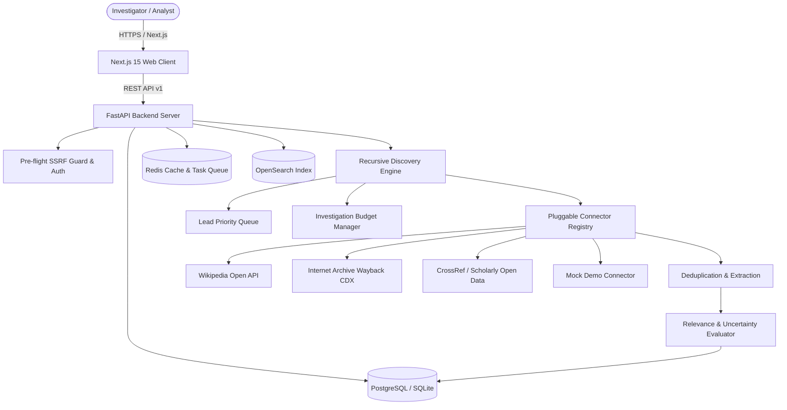

# Architecture & System Design

## 1. Architectural Overview
The **Recursive OSINT Discovery Engine** is built as a modular monorepo combining:
- **FastAPI Core**: Asynchronous REST API managing investigations, users, queries, and reports.
- **Autonomous Recursive Engine**: Bounded priority-queue controller that iteratively expands leads, evaluates stopping rules, extracts entities, and cross-references sources.
- **Source Connector Framework**: Pluggable adapters querying Wikipedia, Internet Archive, CrossRef scholarly records, open corporate datasets, and external search APIs.
- **Defensive Security Layer**: Pre-flight SSRF protection, strict robots.txt compliance, URL canonicalization, and SHA-256 deduplication.
- **Next.js 15 Web Client**: App Router dashboard featuring real-time investigation progress, live timeline events, interactive evidence cards, and markdown report synthesis.

## 2. Key Modules
- **`backend/src/recursive_osint/discovery/`**: Contains the state machine, budget limits, lead priority queue, stopping rules, and recursive controller.
- **`backend/src/recursive_osint/connectors/`**: Base connector interface and implementations for public data sources.
- **`backend/src/recursive_osint/core/security.py`**: Strict SSRF guard, Argon2id/SHA-256 password hashing, and JWT handling.
- **`apps/web/`**: Next.js 15 frontend with dark cyber aesthetic, glassmorphic UI, and live status polling.
